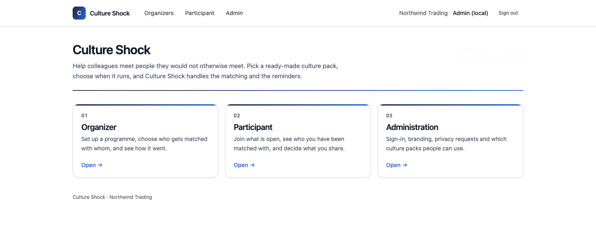
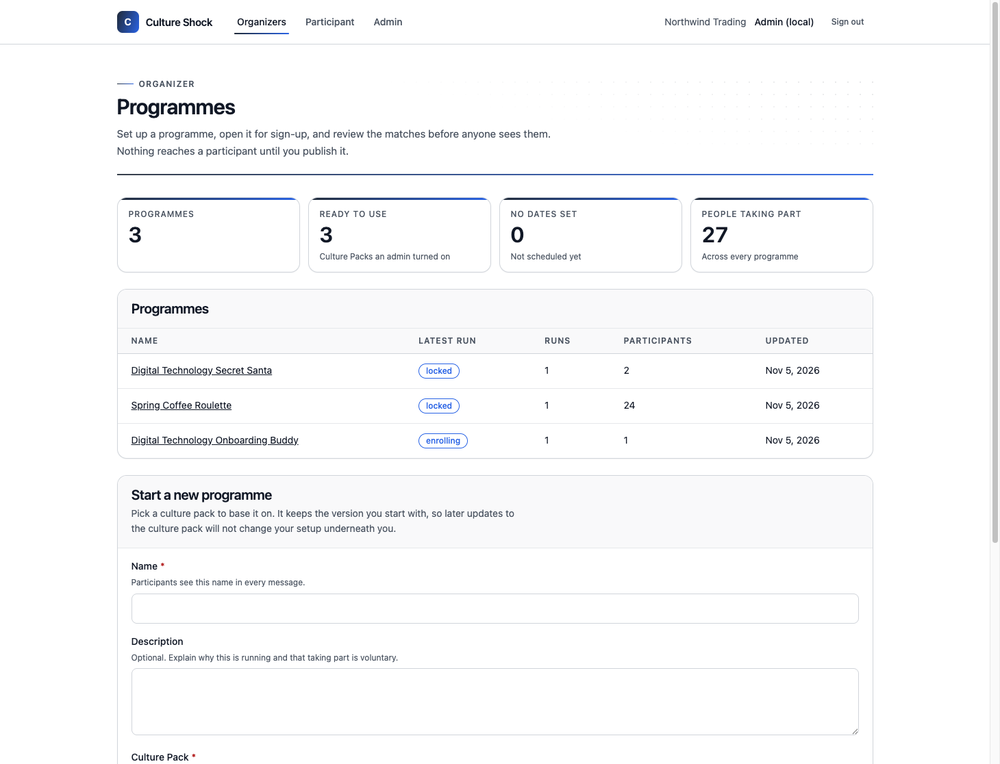
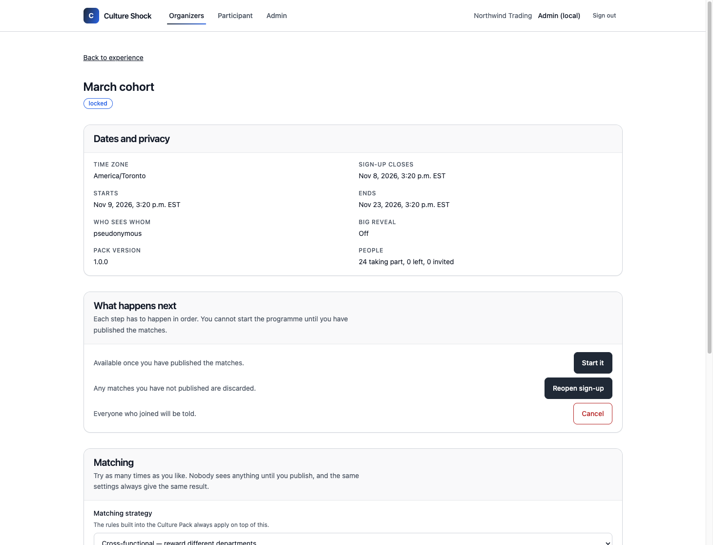
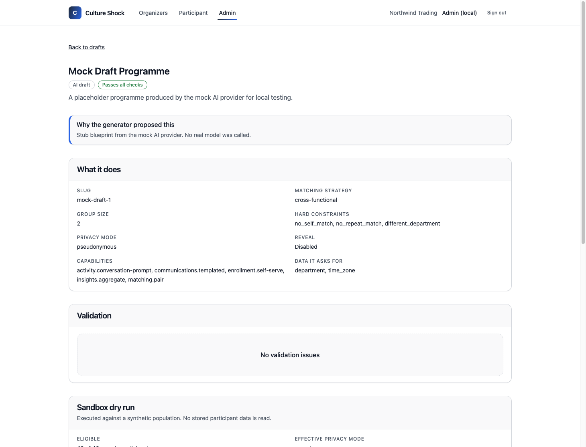
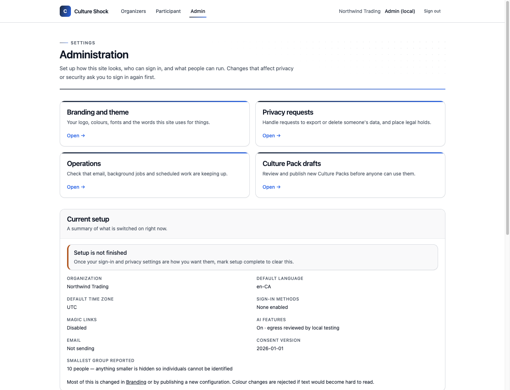
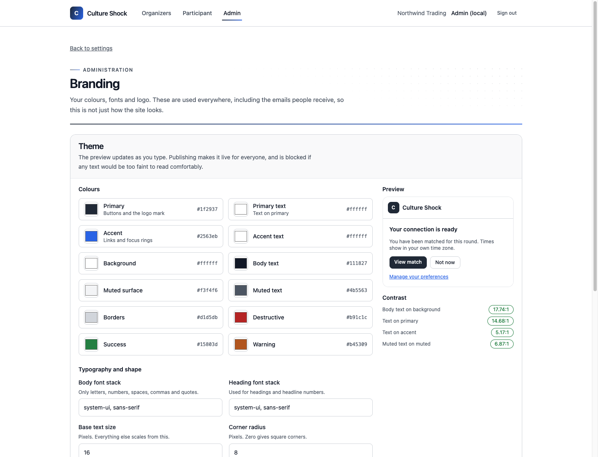
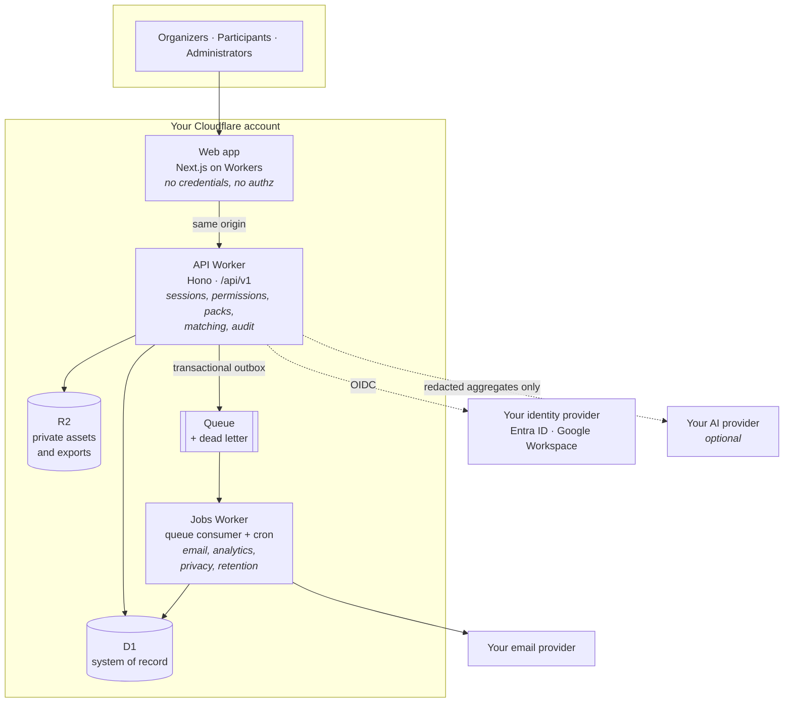

# Culture Shock

Culture Shock runs workplace connection programmes inside your own Cloudflare account. Secret Santa, coffee roulette, appreciation weeks, buddy schemes for new starters. You clone the repository, point it at your own D1 database and identity provider, and deploy. Nobody else operates it and nobody else holds the data.

A programme is described by a **Culture Pack**: a versioned JSON file covering objectives, who is eligible, how people get matched, what they are asked to do, and what messages get sent. Packs are data. The platform interprets them through a fixed set of capabilities that live in the source, so adding a programme does not mean adding code, and a pack cannot reach anything the platform does not already know how to do.

Five packs ship with the project: Secret Santa, Appreciation Week, Coffee Roulette, New Hire Buddy, and Cross-Team Connector. Writing your own is a JSON file and an afternoon.



## What it does

**Run a programme end to end.** Pick a Culture Pack, set the dates, open sign-up, generate matches, review them, publish. Every step is guarded server-side and recorded in an audit trail.

**Match people deliberately.** Five strategies — cross-functional, diversity-optimised, remote-first, new-hire-friendly and leadership-mix. Hard constraints from the pack resolve before any scoring, so "never match two people in the same team" is not a preference that can be outvoted.

**Measure without surveilling.** Aggregate metrics only, with any group below your configured minimum hidden rather than shown as a small percentage. There is no route anywhere that reports on an individual.

**Make it yours.** Colours, fonts, logo and every product noun are configuration. Upload a WOFF2 and the typeface changes everywhere, including email. Publishing is blocked if your colours would make text hard to read.

**Use AI, or don't.** AI can suggest a pack or draft a new one, but it cannot publish anything, match anyone, or send a message. Every AI path has a deterministic fallback and the product is fully usable with every provider switched off.

**Handle privacy requests properly.** Export and erasure are first-class, with legal holds, and an export reduces every other person in it to a pseudonym.

### The organizer's view

A programme is a reusable plan; each run is a scheduled execution of it.



Inside a run, the lifecycle controls only ever offer transitions the server will actually accept, and matching can be re-run as often as you like because nothing is visible until you publish.



### Drafting a pack with AI

An administrator describes an outcome in plain language. The platform builds the workflow, rules and capability list; the model only fills in content. The result is a **draft**, not an installation: it is validated, executed against a synthetic forty-person population, and its messages are rendered for inspection before anyone can publish it. Publishing requires an explicit, separately audited approval, and the pack arrives disabled.



### Administration



Branding previews live and is rejected on publish if any text and background pair falls below 4.5:1.



## Quick start

You need Node 22 or newer and pnpm.

```bash
git clone https://github.com/cooperwatts/culture-shock.git
cd culture-shock
pnpm install
pnpm test
```

To bring up the API and the web app against a local D1:

```bash
cp apps/api/.dev.vars.example apps/api/.dev.vars   # then generate the keys it asks for
pnpm db:migrate:local
pnpm dev:api     # http://localhost:8788
pnpm dev:web     # http://localhost:3000
```

With both running, populate it with an organization, an enabled pack and a run with
twenty-four enrolled people:

```bash
pnpm seed:dev
```

That prints sign-in links. Local development uses a sign-in route that skips the
identity provider, so you do not need an Entra or Google tenant to look around.
It refuses to run outside `ENVIRONMENT=development`.

[docs/install.md](docs/install.md) covers a real deployment, including the one-time bootstrap call.

## How the pieces fit

Three Workers and a Next.js app, all in one repository.



The **API Worker** owns everything that matters: sessions, permissions, pack interpretation, matching, and the audit trail. The **jobs Worker** handles anything that should not block a request, which means notification delivery, analytics refreshes, privacy requests, and retention sweeps. The **web app** holds no credentials and makes no authorization decisions of its own; it reads from the API on the same origin and renders what comes back.

D1 is the system of record. R2 holds private assets and exports. A Cloudflare Queue carries background work, fed from a transactional outbox so an event can never exist without the state change that produced it.

### Built with

|                |                                                                            |
| -------------- | -------------------------------------------------------------------------- |
| **Runtime**    | Cloudflare Workers, Node 22+ for tooling                                   |
| **API**        | [Hono](https://hono.dev) on Workers, serving `/api/v1`                     |
| **Web**        | Next.js 15 (App Router, React 19) via OpenNext, Tailwind CSS               |
| **Language**   | TypeScript 5.9, `strict`, project references                               |
| **Data**       | Cloudflare D1 (SQLite), R2 for private objects, Queues for background work |
| **Validation** | Zod schemas shared between the API and the web app                         |
| **Identity**   | OIDC against Microsoft Entra ID or Google Workspace                        |
| **Email**      | Resend, SendGrid, MailChannels, or your own SMTP relay                     |
| **AI**         | OpenAI, Azure OpenAI, Anthropic or Workers AI — all optional               |
| **Tests**      | Vitest                                                                     |
| **Repo**       | pnpm workspaces                                                            |

Nothing here requires a managed service outside your own Cloudflare account, apart
from the identity, email and AI providers you choose to point it at.

| Path                      | What lives there                                               |
| ------------------------- | -------------------------------------------------------------- |
| `apps/api/`               | Hono Worker serving `/api/v1`                                  |
| `apps/jobs/`              | Queue consumer and scheduled jobs                              |
| `apps/web/`               | Next.js interfaces for designers, participants, administrators |
| `packages/domain/`        | Entities, lifecycle rules, authorization, consent              |
| `packages/rules/`         | The rule DSL and its evaluator                                 |
| `packages/pack-sdk/`      | Manifest schema, validation, dry-run sandbox                   |
| `packages/matching/`      | Matching strategies and the scoring pipeline                   |
| `packages/ai/`            | Provider adapters and the orchestration layer                  |
| `packages/notifications/` | Message rendering and email providers                          |
| `packages/observability/` | Structured logging and health checks                           |
| `packs/`                  | The five built-in manifests                                    |
| `db/migrations/`          | Ordered D1 migrations                                          |

## Rules the platform will not bend

These are enforced in code, not left to reviewer discipline.

A pack manifest cannot execute JavaScript, fetch a URL, run SQL, invent a metric, or ask for data the installation has not permitted. Unknown fields fail the import outright rather than being ignored.

AI never publishes a pack, commits a set of matches, or sends a message. Every AI path has a deterministic fallback, and the product works with every provider switched off. External AI calls stay blocked until an administrator records a data-egress review, and a request whose data classification exceeds the configured ceiling is rejected before the provider is contacted.

Matching is reproducible. Hard constraints resolve before any weighting, ties break on stable identifiers, and a participant who cannot be matched is reported for a human decision instead of being dropped.

Anything below the configured cohort threshold is suppressed, in fairness reports and in anything sent to a model.

Home addresses, personal email addresses and phone numbers are never collected. If people want to exchange physical gifts, they arrange it between themselves.

A data subject export reduces every other person in it to a pseudonym, so an export request cannot be used to learn about colleagues.

## Documentation

Start at [docs/](docs/README.md). The most useful entry points:

- [Installing on Cloudflare](docs/install.md)
- [Configuration reference](docs/configuration.md)
- [Writing a Culture Pack](docs/guides/writing-a-culture-pack.md)
- [Running an installation](docs/operations/README.md)
- [Scope](docs/scope.md), covering what is in the box and what is intentionally not
- [Local development](docs/development.md)

## Contributing

Pull requests are welcome. [CONTRIBUTING.md](CONTRIBUTING.md) explains how the repository is laid out, what the test suite expects, and which changes need more review than others. Changes to privacy, matching fairness, or the pack capability surface get scrutinised harder than the rest, and that is deliberate.

New Culture Packs are the easiest useful contribution: they are data files, and they do not require you to understand the platform internals.

## Security

Please do not open a public issue for a vulnerability. [SECURITY.md](SECURITY.md) has the reporting process.

## Licence

Apache 2.0. See [LICENSE](LICENSE).
