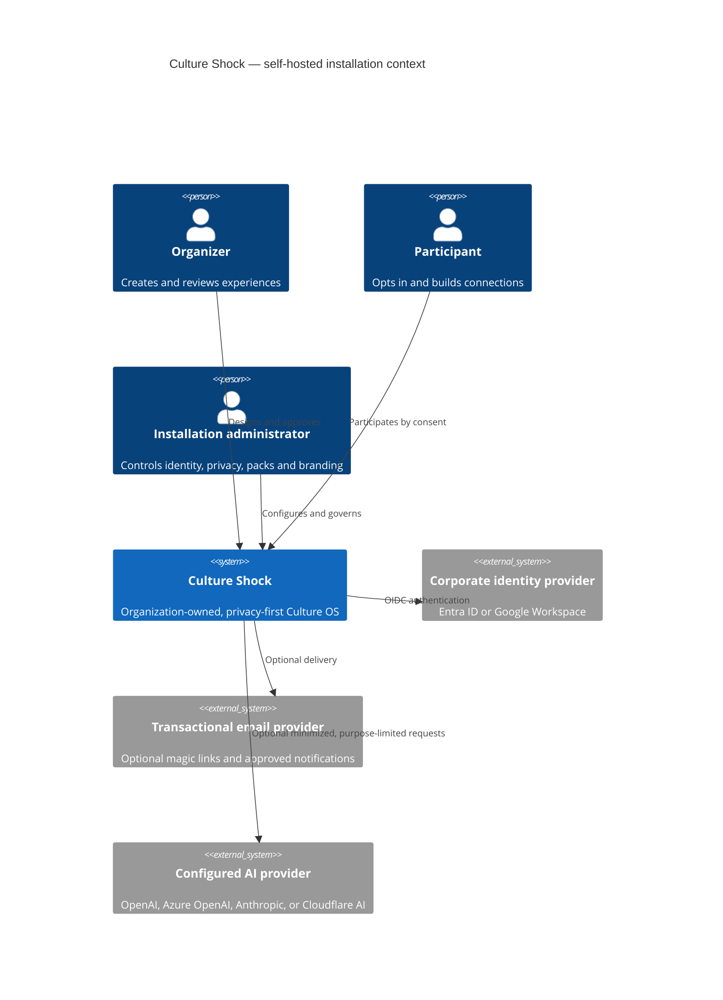
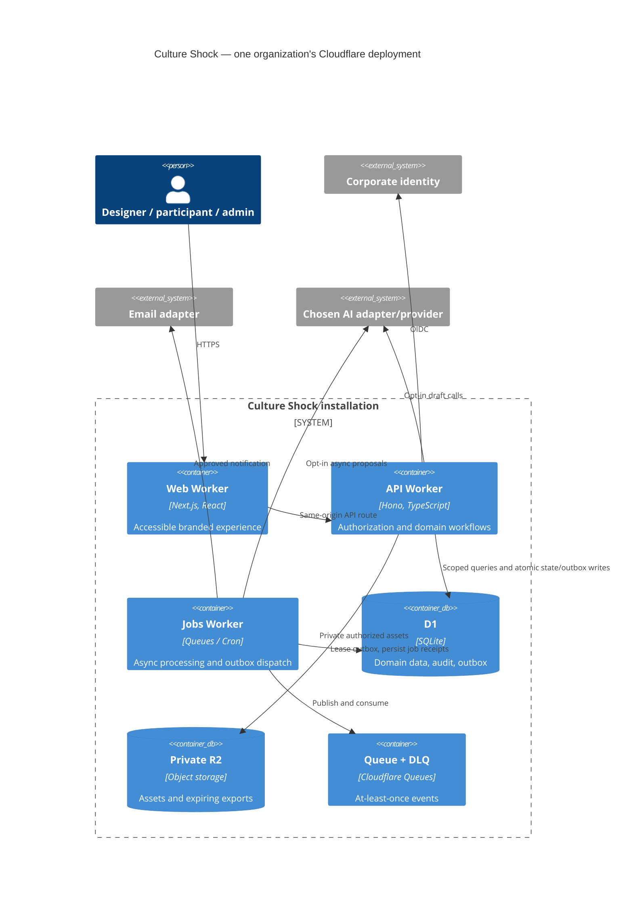
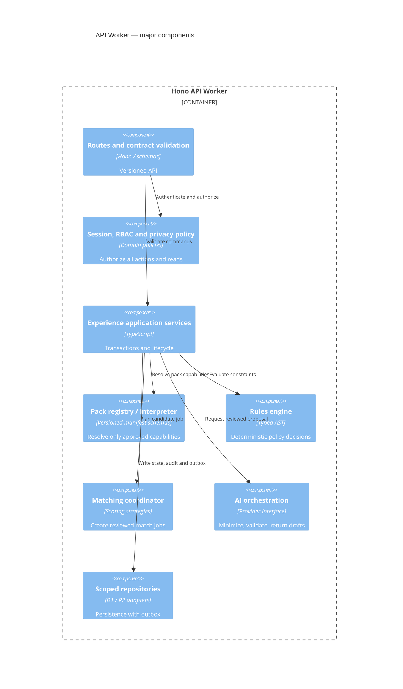
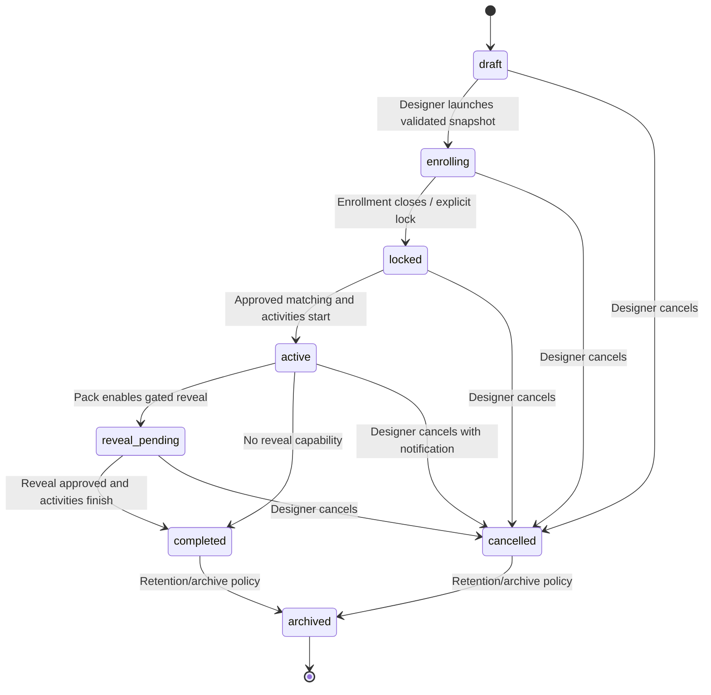
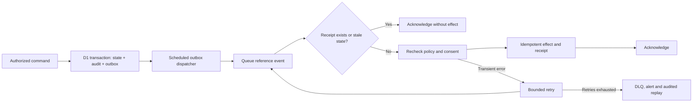

# 5. C4 diagrams, sequences, lifecycle, roadmap

## C4 Level 1 — system context



## C4 Level 2 — deployment containers



## C4 Level 3 — API Worker components



## Sequence — create and launch an experience with Copilot

```mermaid
sequenceDiagram
  actor D as Organizer
  participant W as Web
  participant A as API/policy
  participant AI as AI adapter
  participant P as Pack validator/rules
  participant DB as D1 + outbox
  participant J as Queue consumer
  D->>W: State objectives and inclusion goals
  W->>A: POST /copilot/recommendations (opt-in)
  A->>A: Authorize; classify and minimize input
  A->>AI: Typed, redacted proposal request
  AI-->>A: Candidate plans
  A->>P: Validate capabilities, privacy and schema
  A-->>W: Draft recommendations + risks
  D->>W: Choose pack, edit rules and schedule
  W->>A: Create Experience and Instance
  A->>P: Dry-run workflow and policy
  A->>DB: Store draft and audit atomically
  D->>W: Approve launch
  W->>A: POST /instances/:id/launch (idempotent)
  A->>DB: Compare-and-swap state; snapshot + audit + outbox
  DB-->>J: Outbox dispatcher sends reference event
  J->>DB: Re-check state and consent; record delivery
  J-->>D: Enrollment communication scheduled
```

## Sequence — matching, publication and reveal

```mermaid
sequenceDiagram
  actor D as Organizer
  actor U as Participant
  participant A as API
  participant Q as Queue
  participant M as Matching engine
  participant DB as D1
  D->>A: Request match preview
  A->>DB: Snapshot eligible, consented memberships; create run/outbox
  DB-->>Q: Dispatcher publishes run reference
  Q->>M: Run scoring job (at least once)
  M->>DB: Load current snapshot; apply hard rules
  M->>M: Optimize bounded scores and assess fairness
  M->>DB: Save candidate matches and diagnostics idempotently
  D->>A: Inspect unmatched and fairness report
  D->>A: Publish run with If-Match
  A->>DB: Verify state; publish once; audit + outbox
  U->>A: Request my match
  A->>DB: Check membership and privacy mode
  A-->>U: Permitted peer fields / pseudonym only
  opt Pack permits scheduled reveal
    D->>A: Authorize reveal
    A->>DB: Check policy/time; commit reveal + outbox
    U->>A: Request revealed relationship
    A-->>U: Allowed peer identity only
  end
```

## Experience event lifecycle





## Phase-based MVP roadmap and exit gates

| Phase | Deliverable | Exit gate |
| --- | --- | --- |
| 0 — architecture approval | Confirm installation scope, privacy/legal defaults, supported packs, Cloudflare adapter/plan, email delivery, OSS license choice and threat model | Explicit sign-off on this proposal; no code before gate |
| 1 — secure foundation | Monorepo, build/test CI, Cloudflare bindings, migration system, config/theme, OIDC, sessions, RBAC, audit, contract/schema generation | Tenant-scoped auth/IDOR negative tests, deployment smoke test, accessibility baseline |
| 2 — extensible core | Data-only pack registry, interpreter, rules DSL, experience lifecycle, enrollment/opt-out, notifications/outbox, five manifest fixtures | Pack conformance/dry-run, retries/idempotency tests, no pack-ID core branches |
| 3 — connection MVP | Scoring matching strategies, Secret Santa (digital-first), Appreciation Week, Coffee Roulette; participant views and restricted reveal | 1,200-person performance test, consent/reveal/odd-count edge cases, WCAG audit |
| 4 — breadth and intelligence | New Hire Buddy, Cross-Team Connector; opt-in AI Copilot and pack builder, provider adapters, human approval flow | Privacy egress audit, disabled-AI fallback, generated-pack validation, abuse tests |
| 5 — insights and release | Suppressed metrics, AI recommendations, branding localization, install docs, backup/restore, observability and OSS contribution policy | Red-team, privacy erasure/export, DR rehearsal, independent self-host install |
| Later — enterprise expansion | SCIM, SAML, advanced content moderation, reviewed new capability SDK, broader packs | Separate security/privacy review per feature |

Decisions deferred to phase 0: license and governance, actual email provider, regional data-processing constraints, which AI providers may receive which purpose/data, default retention by employer/legal context, target supported languages/locales, throughput budget/Cloudflare pricing, and whether installation-level administrators require step-up auth. These are configuration/policy questions, not excuses to weaken the MVP's security defaults.
